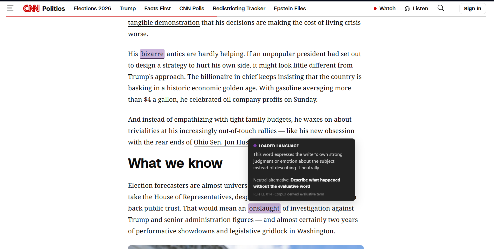
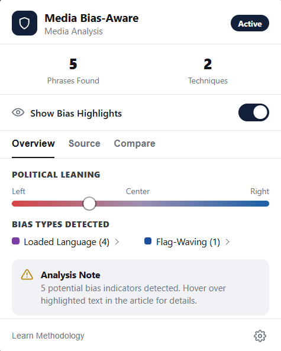
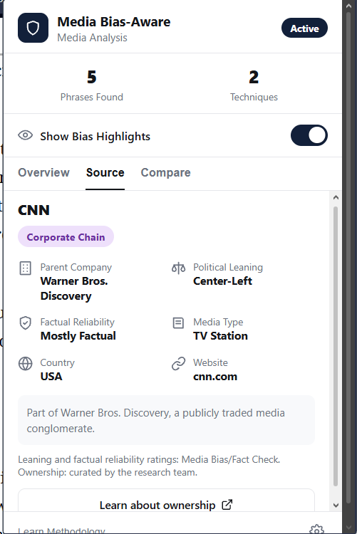

# Media Bias-Aware Browser Extension

A Chrome extension that helps readers notice potential bias cues while reading online news. It highlights wording that matches 14 propaganda techniques, explains each highlight in plain language, shows information about the outlet, and suggests coverage from other outlets. Detection runs entirely on the reader's device.

Undergraduate thesis, *Development of a Media Bias-Aware Browser Extension for Balanced News Consumption*, Bachelor of Science in Computer Science, Cavite State University, 2026.

- **Researchers:** Kobi P. Pareja and Orchard Hernandez
- **Adviser:** Ms. Julie Ann C. Lontoc
- **Technical Critic:** Mr. Dan Joseph A. Ortega

> Highlights are cues for the reader to weigh. They are not verdicts: the extension gives no bias score and does not label an article as biased or unbiased.

## Screenshots

**Highlights with an explanation for each one**



| Article summary | Outlet information |
|---|---|
|  |  |

## Features

- **Phrase-level highlights:** 39 rules (catalog version 1.1.0) covering the 14 SemEval-2020 Task 11 techniques. Each tooltip names the technique and rule and explains the flag.
- **Outlet information:** political leaning and factual reliability for about 8,800 outlets, from an offline lookup table, with ownership details for 43 curated outlets.
- **Comparison view:** related Left, Center, and Right coverage through NewsAPI, using your own API key. This feature is optional.
- **Privacy:** article text stays on the page. The optional comparison request sends topic keywords only, and the API key is stored encrypted.

## How detection works

The extension extracts the article text with Readability.js and tags it with Compromise. A phrase is flagged only when all three conditions of a rule hold:

```
Detected = Lexical trigger AND Linguistic condition AND Context condition
```

Overlapping detections are then resolved so that one highlight remains, and the rest are kept in an audit log. Quoted speech is skipped by default because it is a source's wording, not the outlet's. Slogan rules are the exception.

The rules are plain JSON in [`data/pattern-catalog.json`](data/pattern-catalog.json). See the [technical notes](docs/technical-notes.md) for the schema and design decisions.

## Install

1. Download or clone this repository.
2. Open `chrome://extensions` and turn on **Developer mode**.
3. Click **Load unpacked** and select the repository folder.
4. Open a news article and click the extension icon. Refresh any tab that was already open.

[`test/test-article.html`](test/test-article.html) is a sample page for trying the highlights.

## Run the tests

Requires [Node.js](https://nodejs.org/). There is no build step and nothing to install.

```
node --test test/*.test.js
```

The suite has 261 tests: 248 pass, and 13 are marked as known limitations.

## Evaluation results

The extension was evaluated on 30 news articles (10 Left, 10 Center, 10 Right) with three validators, and with 15 CvSU students using one test article. Results are reported as obtained. Full details are in Chapters 4 and 5 of the thesis.

| Measure | Target | Result | Status |
|---|---|---|---|
| False positive rate on 75 held-out SemEval articles (Gate 2) | Below 15% | 68.4% (keyword baseline: 73.9%) | Not met |
| Processing time (Gate 3) | Under 3,000 ms | All 310 runs under 3,000 ms; median 67 ms | Met |
| Validator agreement, Fleiss' kappa (Gate 1) | At least 0.60 | -0.218 (Gwet's AC1: 0.073) | Not met |
| Precision on the 30 articles (EC1) | At least 0.50 | 5.3% (1 of 19 highlights) | Not met |
| Recall on the 30 articles (EC1) | At least 0.30 | 25.0% (1 of 4 reference spans) | Not met |
| Usability constructs, mean of 5 (Gate 4) | At least 3.50 | 4.74 and 4.69 | Met |
| Questionnaire reliability, Cronbach's alpha (Gate 4) | At least 0.70 | 0.94 | Met |
| Task completion (EC4) | At least 80% per task | 86.7% to 100% | Met |

Only 4 reference spans were formed, so the precision and recall figures rest on very few spans. The rule conditions removed 50 of the keyword baseline's 68 false positives on the 30 articles. Test logs are in [`eval/reports/`](eval/reports/).

## Known limitations

- Seven techniques are only partly implemented. Repetition across an article is not detected.
- Text added after the page's single scan is not checked until the page is reloaded.
- Outlet labels provide context and are not ground truth.
- NewsAPI's free plan has request limits and delays articles by about 24 hours.

## Repository guide

| Folder | Contents |
|---|---|
| `content/` | Article extraction, rule matching, conflict resolution, and highlighting |
| `popup/`, `compare/`, `about/` | Extension popup, comparison view, and methodology page |
| `background/`, `shared/` | Service worker, comparison helpers, and encrypted key storage |
| `data/` | Rule catalog, outlet metadata, and curated ownership data |
| `eval/` | Evaluation scripts and test reports |
| `test/` | Automated tests |
| `lib/`, `icons/`, `scripts/` | Third-party libraries, icons, and data scripts |
| `docs/` | Technical notes and images |

## Data availability

The evaluation articles, validator annotations, and participant responses are not in this repository, because they include copyrighted news text and research data. They are available to the thesis panel on request. The SemEval-2020 Task 11 dataset is not redistributed here and must be obtained from its authors.
